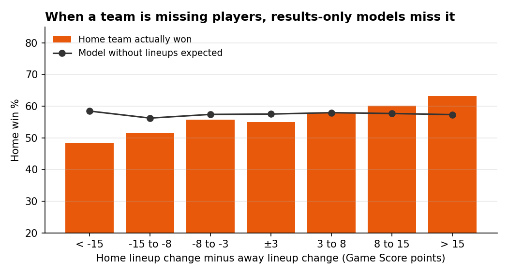
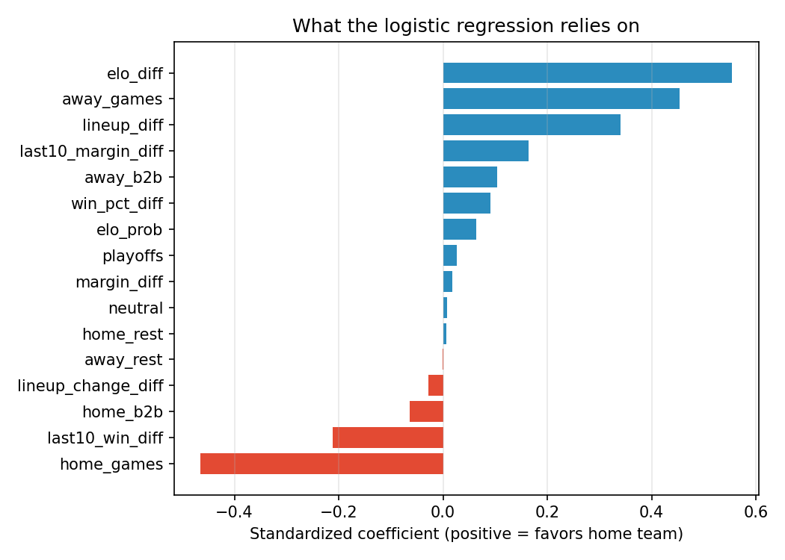

# NBA Game Predictor 🏀

**[🔗 Live site: today's picks and track record](https://pushtishah11.github.io/nba-game-predictor/)** ·
**[📝 Write-up: what predicts an NBA game?](https://pushtishah11.github.io/nba-game-predictor/writeup.html)**

Predicts the winner of NBA games from team strength, recent form, rest, and **who's
actually playing**. It's trained on about 15,700 games from 2014-15 to today and tested
**walk-forward**: to score a season, the model trains only on the seasons before it.

**Result:** **66.3%** of games picked correctly on seasons the model never saw,
up from 56.0% for always picking the home team. Adding player availability was the
biggest single improvement (65.3% → 66.3%). The betting market is still better
(67.8% on the same games), and the [comparison](results/market.md) is included.


## Results

Walk-forward evaluation over 2017-18 through the current season (11,753 games):

| Model | Accuracy | Log loss | Brier |
|---|---|---|---|
| **Logistic regression** | **66.3%** | **0.6127** | **0.2123** |
| Gradient boosting | 65.6% | 0.6183 | 0.2145 |
| Logistic regression, no lineup features | 65.3% | 0.6221 | 0.2165 |
| Elo rating only | 64.6% | 0.6337 | 0.2212 |
| Always pick home team | 56.0% | 0.6863 | 0.2466 |
| *Betting market (11,741 of the same games)* | *67.8%* | *0.5983* | *0.2060* |

Lower is better for log loss and Brier score. Both measure whether the
*probabilities* are good, not just the picks. Per-season numbers are in
[`results/metrics.md`](results/metrics.md).

**Takeaways**
- **Elo does most of the work.** One rating per team, updated after every game,
  gets within two points of the full model.
- **Injuries are the biggest missing signal in score-only models.** When the home team
  is missing much more talent than usual it wins 48% of the time, yet a results-only
  model still expects about 58%. Lineup features fix most of that.
- **Back-to-backs matter.** Home teams win 56% when both teams are rested, 61% when
  the visitors are on a back-to-back, and 50% when the home team is.
- **Gradient boosting doesn't beat logistic regression** here. With about 16 mostly
  linear features there's little non-linear signal to find, so the simpler
  model wins and is easier to explain.
- **Home-court advantage has shrunk.** Home teams won 58.4% of games before 2019-20 and
  55.1% since 2020-21.
- **Vegas is still better.** When the model and the market disagree (about 1 game in 9),
  the market is right 57% of the time. Blending the two doesn't help, and betting on the
  model's edges would have lost about 6.5%. Lineups did close about 40% of the log-loss
  gap to the market.

More in the [write-up](https://pushtishah11.github.io/nba-game-predictor/writeup.html).



<p float="left">
  
  
</p>

*Left: the probabilities are well calibrated. When the model says 75%, the home
team wins about 75% of the time. Right: the logistic regression's weights. Many
features overlap (Elo, win %, and margin all measure team strength), so don't
over-read single weights. For example, `home_games` and `away_games` cancel out,
so the model is really using the difference between them.*

## How it works

1. **Scrape** ([`src/scrape.py`](src/scrape.py), [`src/boxscores.py`](src/boxscores.py)):
   downloads every game's final score and the upcoming schedule from Basketball-Reference,
   and every player's box score from ESPN's public API. Both cache past seasons.
2. **Features** ([`src/features.py`](src/features.py)): for every game, using only
   games played *before* it:
   - **Elo ratings** with home-court advantage, a margin-of-victory multiplier, and
     regression toward the mean between seasons
   - Season win % and average point margin
   - Last-10-game win % and margin (recent form)
   - Days of rest and back-to-back flags
   - Neutral-site games (Paris, Mexico City, ...) and playoff flag
   - **Lineups** ([`src/availability.py`](src/availability.py)): each player is rated by
     his average Game Score over his last 20 games. A team's lineup value is the sum of
     its best 8 available players. The model sees the lineup gap between the teams and
     how each team's lineup compares with its usual one (last 10 games).

   For past games, "available" means the player actually played, which is slightly
   optimistic. For upcoming games, [`src/injuries.py`](src/injuries.py) uses ESPN's live
   rosters and injury report instead ("Out" = missing, "Day-To-Day" = 50%).
3. **Train** ([`src/train.py`](src/train.py)): walk-forward evaluation of the
   baselines and models above, then fits the final model on every completed game.
4. **Compare with Vegas** ([`src/odds.py`](src/odds.py), [`src/compare.py`](src/compare.py)):
   downloads every sportsbook's final pre-game moneyline from ESPN, converts it to a no-vig
   probability (median across books), and compares it with the model's walk-forward
   predictions, including a market + model blend and a betting simulation.
5. **Predict** ([`src/predict.py`](src/predict.py)): win probabilities for upcoming
   games.

## Quick start

```bash
git clone https://github.com/pushtishah11/nba-game-predictor.git
cd nba-game-predictor
pip install -r requirements.txt

python src/predict.py            # predictions for the next 3 days
```

The repo includes the data and a trained model, so that works right away. To refresh
with the latest results and retrain:

```bash
python src/scrape.py      # ~1 min (past seasons are cached)
python src/boxscores.py   # first run ~25 min, then seconds
python src/features.py
python src/train.py
python src/odds.py        # betting lines, first run ~8 min
python src/compare.py     # model vs market -> results/market.md
python src/analysis.py    # charts for the write-up
```

Example output:

```
Model trained through 2026-11-13

Sat Nov 14, 2026
            Denver Nuggets @ New Orleans Pelicans      pick: Denver Nuggets (80%)
          Dallas Mavericks @ Cleveland Cavaliers       pick: Cleveland Cavaliers (68%)
             Brooklyn Nets @ Memphis Grizzlies         pick: Memphis Grizzlies (68%)
           Detroit Pistons @ Miami Heat                pick: Detroit Pistons (69%)
             Chicago Bulls @ Minnesota Timberwolves    pick: Minnesota Timberwolves (90%)
```

## Website

The [live site](https://pushtishah11.github.io/nba-game-predictor/) is a static page
([`docs/index.html`](docs/index.html)) hosted free on GitHub Pages. A GitHub Action
([`.github/workflows/update.yml`](.github/workflows/update.yml)) runs every morning. It:

1. scrapes the latest scores, schedule, and box scores
2. runs [`src/export.py`](src/export.py), which pulls the injury report, predicts the next week
   of games, and writes `docs/data.json`
3. commits the update, which redeploys the site

Every prediction is also saved to `data/prediction_log.csv` before tip-off and frozen once the
game starts, so the site's **live track record** only counts picks made in advance.

To preview the site locally:

```bash
python src/export.py
python -m http.server --directory docs 8000   # then open http://localhost:8000
```

## Project structure

```
├── data/
│   ├── raw/          # one CSV per season, straight from the scraper
│   │   └── box/      # player box scores, one gzipped CSV per season
│   ├── games.csv     # all games combined
│   └── features.csv  # model-ready features
├── models/model.joblib
├── docs/             # the website (index.html, writeup.html, data.json, img/)
├── results/          # metrics and charts
└── src/              # scrape → features → train → predict / export
```

## Ideas for next steps

- Find what the market knows that the model doesn't (minutes limits? late news? matchups?)
- A better player rating than Game Score, e.g. one based on plus-minus
- Use box-score stats like offensive/defensive rating instead of just points
- Predict point spreads, not just winners

## Data

Game results are from [Basketball-Reference](https://www.basketball-reference.com/). Box scores,
rosters, injury reports, and betting lines are from ESPN's public site API.
This is a personal, educational project and is not affiliated with the NBA.
