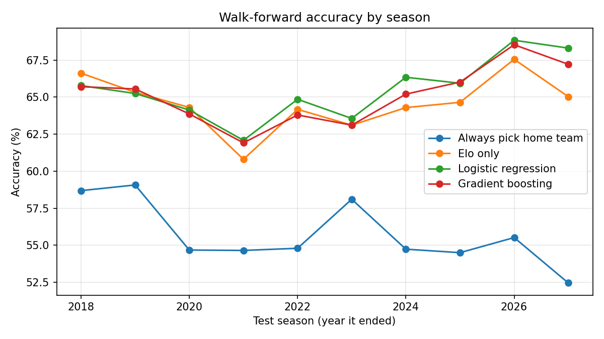
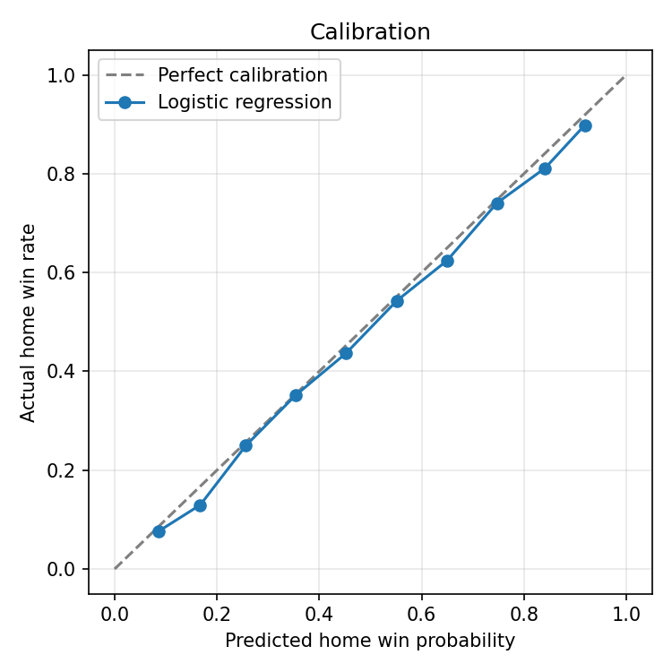

# NBA Game Predictor 🏀

**[🔗 Live site: today's picks and track record](https://pushtishah11.github.io/nba-game-predictor/)**

Predicts the winner of NBA games from team strength, recent form, and rest.
It's trained on about 15,000 games from 2014-15 to today and tested **walk-forward**:
to score a season, the model trains only on the seasons before it.

**Result:** **65.3%** of games picked correctly on seasons the model never saw,
up from 56.1% for always picking the home team, using nothing but final scores
and the schedule.



## Results

Walk-forward evaluation over 2017-18 through the current season (11,726 games):

| Model | Accuracy | Log loss | Brier |
|---|---|---|---|
| **Logistic regression** | **65.3%** | **0.6220** | **0.2165** |
| Gradient boosting | 64.9% | 0.6270 | 0.2185 |
| Elo rating only | 64.6% | 0.6337 | 0.2212 |
| Always pick home team | 56.1% | 0.6862 | 0.2465 |

Lower is better for log loss and Brier score. Both measure whether the
*probabilities* are good, not just the picks. Per-season numbers are in
[`results/metrics.md`](results/metrics.md).

**Takeaways**
- **Elo does most of the work.** One rating per team, updated after every game,
  gets within a point of the full model.
- **Recent form and rest add a little on top.** Back-to-backs matter: a tired
  road team is easier to beat.
- **Gradient boosting doesn't beat logistic regression** here. With about 14 mostly
  linear features there's little non-linear signal to find, so the simpler
  model wins and is easier to explain.
- **Home-court advantage has shrunk.** Home teams won about 59% of games before 2020 and
  about 55% since. The 2020 bubble had no crowds at all, and that's visible in the data.

<p float="left">
  
  
</p>

*Left: the probabilities are well calibrated. When the model says 75%, the home
team wins about 75% of the time. Right: the logistic regression's weights. Many
features overlap (Elo, win %, and margin all measure team strength), so don't
over-read single weights. For example, `home_games` and `away_games` cancel out,
so the model is really using the difference between them.*

## How it works

1. **Scrape** ([`src/scrape.py`](src/scrape.py)): downloads every game's final score
   and the upcoming schedule from Basketball-Reference, with polite rate limiting
   and a per-season cache.
2. **Features** ([`src/features.py`](src/features.py)): for every game, using only
   games played *before* it:
   - **Elo ratings** with home-court advantage, a margin-of-victory multiplier, and
     regression toward the mean between seasons
   - Season win % and average point margin
   - Last-10-game win % and margin (recent form)
   - Days of rest and back-to-back flags
   - Neutral-site games (Paris, Mexico City, ...) and playoff flag
3. **Train** ([`src/train.py`](src/train.py)): walk-forward evaluation of the
   baselines and models above, then fits the final model on every completed game.
4. **Predict** ([`src/predict.py`](src/predict.py)): win probabilities for upcoming
   games.

## Quick start

```bash
git clone https://github.com/pushtishah11/nba-game-predictor.git
cd nba-game-predictor
pip install -r requirements.txt

python src/predict.py            # predictions for the next 3 days
```

The repo includes the data and a trained model, so that works right away. To refresh
with the latest results and retrain:

```bash
python src/scrape.py     # ~1 min (past seasons are cached)
python src/features.py
python src/train.py
```

Example output:

```
Model trained through 2026-11-13

Sat Nov 14, 2026
            Denver Nuggets @ New Orleans Pelicans      pick: Denver Nuggets (80%)
          Dallas Mavericks @ Cleveland Cavaliers       pick: Cleveland Cavaliers (68%)
             Brooklyn Nets @ Memphis Grizzlies         pick: Memphis Grizzlies (68%)
           Detroit Pistons @ Miami Heat                pick: Detroit Pistons (69%)
             Chicago Bulls @ Minnesota Timberwolves    pick: Minnesota Timberwolves (90%)
```

## Website

The [live site](https://pushtishah11.github.io/nba-game-predictor/) is a static page
([`docs/index.html`](docs/index.html)) hosted free on GitHub Pages. A GitHub Action
([`.github/workflows/update.yml`](.github/workflows/update.yml)) runs every morning. It:

1. scrapes the latest scores and schedule
2. runs [`src/export.py`](src/export.py), which predicts the next week of games and writes `docs/data.json`
3. commits the update, which redeploys the site

Every prediction is also saved to `data/prediction_log.csv` before tip-off and frozen once the
game starts, so the site's **live track record** only counts picks made in advance.

To preview the site locally:

```bash
python src/export.py
python -m http.server --directory docs 8000   # then open http://localhost:8000
```

## Project structure

```
├── data/
│   ├── raw/          # one CSV per season, straight from the scraper
│   ├── games.csv     # all games combined
│   └── features.csv  # model-ready features
├── models/model.joblib
├── docs/             # the website (index.html + data.json)
├── results/          # metrics and charts
└── src/              # scrape → features → train → predict / export
```

## Ideas for next steps

- Add player availability (injuries and rest days are the biggest missing signal)
- Use box-score stats like offensive/defensive rating instead of just points
- Predict point spreads, not just winners
- Compare against betting market lines

## Data

Game results are from [Basketball-Reference](https://www.basketball-reference.com/).
This is a personal, educational project and is not affiliated with the NBA.
